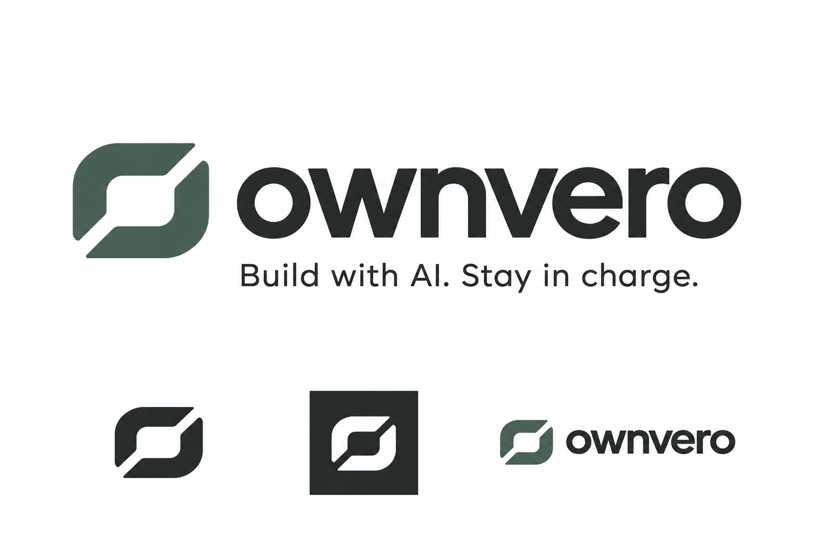

# Ownvero: product ownership for non-technical AI builders

Date: 2026-10-27, Asia/Saigon.
Status: proposed direction and concept identity; not an accepted implementation plan.
Scope: product research, positioning, bounded delivery concept, naming and logo exploration.
No application code, repository identity, deployment, release approval or existing plan was changed.

## Outcome

Give non-technical people building real applications with AI a practical way to
decide what to ask for next, preserve important existing behavior, and accept a
change on observable evidence rather than an agent's completion claim.

The recurring job is not troubleshooting a broken PC. It is owning the next
change to a product, including successful changes made while everything works.

Working positioning:

> Build with AI. Stay in charge.

The opportunity thesis: as implementation becomes easier to delegate, explicit
intent, acceptance, continuity and operational ownership can become valuable
workflows. This is an inference to test, not established demand or a market-size
claim. There is no defensible numerical success probability from this research.

## Constraints and non-goals

- This is advisory work plus a brand concept, not permission to execute a pivot.
- Existing safety/privacy decisions remain binding on the current application.
- Product results must distinguish observation, inference, user confirmation,
  failed verification, unavailable verification and stale evidence.
- No unqualified promise of security, correctness, production readiness or rollback.
- No production database mutations, payments, email sends or deployments by default.
- No business dependence through withheld exports or proprietary-only tests.
- No new IDE, code-generation model, universal autonomous CTO or general task manager.
- No screenshots of unrelated desktop activity, raw credential collection, or
  repurposing private QA evidence as marketing material.

## Acceptance of this brainstorm deliverable

- A new target user and recurring job, not a repackaged file-change dashboard.
- Direct comparison with current builder/testing capabilities.
- A concrete first-session and repeated-use scenario.
- A clear boundary between existing assets and new engineering work.
- A narrow experiment that can reject the thesis.
- A provisional name and visible logo concept, without claiming name clearance.

## Evidence gathered

### Current product

The [README](../../README.md) describes a Windows, non-elevated, local-only
change recorder with deterministic investigations. The implementation already
has workspaces, sanitized history, checkpoints and bounded context export.
The previous [value-loop proposal](brainstorm-261027-user-value-loop.md) centered
on change receipts and incident handoff. These remain useful supporting
capabilities, but they do not establish the new product's primary value.

### Current alternatives, checked 2026-10-27

- [Lovable browser testing](https://docs.lovable.dev/features/browser-testing)
  interacts with project previews, fills forms, captures screenshots and checks
  browser behavior. Browser testing alone is not a new category.
- [Replit App Testing](https://docs.replit.com/features/agent/app-testing)
  describes browser-based self-testing and repair during agent development.
  A second agent saying it checked the first agent is insufficient differentiation.
- [Replit checkpoints](https://docs.replit.com/features/version-control/checkpoints-and-rollbacks)
  already provide version/checkpoint and rollback workflows. Do not market a
  generic undo button as the missing solution or confuse code and production-data recovery.
- [Momentic](https://momentic.ai/) already offers natural-language tests,
  maintenance, browser runs and integration with development workflows. Its
  existence rules out claims that plain-language automated QA is an empty market.
- One [first-person non-coder discussion](https://www.reddit.com/r/nocode/comments/1uovyi5/i_vibecoded_an_internal_tool_at_work_how_do_i_go/)
  describes uncertainty moving a working internal tool toward dependable team
  use, including hosting, data and logins. This is a qualitative anecdote, not
  evidence of prevalence, willingness to pay or the proposed product's fit.

Vendor descriptions establish offered capabilities, not independently measured
quality. Forum anecdotes are self-selected. No user interviews or paid pilots
were conducted in this session.

## New problem framing

Avoid treating non-technical users as incapable. They may understand their
business and steer an AI exceptionally well without wanting to become a software
engineer. The missing support is translating domain intent into a durable,
inspectable development and acceptance process.

Five jobs:

1. Understand what the app actually does and which claims are still unverified.
2. Ask for a change without silently sacrificing working behavior.
3. Know what evidence would make that change acceptable.
4. Carry decisions and evidence between coding tools, sessions or human helpers.
5. Know what remains before a particular release, with honest scope and limits.

The primary product unit becomes a **capability with an owner-approved expected
behavior and current evidence**, rather than a file, event or generic health score.

## Options and trade-offs

| Approach | Load-bearing assumption | First failure | Decision |
|---|---|---|---|
| General AI technical cofounder | A new chat assistant can reliably outperform the user's existing builder across engineering decisions | Confident but unsupported advice, unclear authority, broad implementation burden | Do not start here |
| Independent scanner, tester or rollback tool | The missing need is an isolated verification or recovery function | Builders and established testing tools already provide enough; little repeat differentiation | Supporting capability, not positioning |
| Owner-controlled change and acceptance workflow | Owners will preserve reusable behavior rules and consult evidence before accepting repeated changes | Setup/maintenance feels harder than asking the builder to test again | Recommended bounded experiment |

Better approach to the earlier proposal: move from recording changes in files or
machines to maintaining the owner's definition of working software. The evidence
is the existing competition in history, rollback and browser testing, plus the
current product's incident-first scope. The operational delta is substantial:
new workflow model, execution/evidence integrations and likely a web-facing
surface. This is not a rename-sized change.

## Product concept

Working brand: **Ownvero**.
Plain-language category: the owner's workspace for an AI-built application.

### 1. My app

An owner sees capabilities such as booking, saved orders or customer access, not
an initial screen of services, ports and files. Each card distinguishes:

- expected behavior confirmed by the owner;
- which named scenarios were checked on which build and environment;
- failed scenarios;
- not checked / unable to check;
- evidence that became stale after a change.

AI may suggest capabilities and questions from the connected preview or selected
source. Suggestions are not treated as observed facts. The owner confirms intent.
Do not infer a configured integration, permissions policy or working backend
merely from a dependency name, UI label or screenshot.

### 2. Change request

The owner says what they want to add. The product prepares a short brief with:

- desired outcome and a concrete example;
- existing behaviors to preserve;
- a few missing business choices the user can actually answer;
- required acceptance scenarios and out-of-scope actions;
- current relevant evidence and known gaps.

The user copies that brief into their existing builder. This initial handoff
does not require privileged IDE integration or an unsupported claim that the
product controls all external agents.

### 3. Acceptance, not another completion message

After the change, run the approved scenarios in an isolated, authorized test
environment. Show expected versus observed behavior with reproducible steps.

An AI can draft or repair a test locator; it cannot silently relax the expected
outcome, remove an assertion, or approve its own change to the user's rule.
Record such edits for approval. Separate checks derived from owner requirements
from checks inferred from implementation, which can share the same mistakes.

If a scenario cannot run, its status is unknown or blocked, never passed.
User acceptance is a decision distinct from machine verification results.

### 4. Portable project memory

Accumulate confirmed business rules, important decisions, tested scenarios and
their evidence, known gaps, and bounded handoff briefs. Export readable records
and runnable tests where supported. Do not promise perfect migration of vendor
chat history, credentials, database state or hosting configuration.

This is the retention hypothesis: the project-specific record becomes useful
across many successful iterations. It is not a plan to trap users' data.

## Concrete repeated-use scenario

Illustrative future behavior, not currently implemented:

1. A non-technical operator has built a small booking app in an existing builder.
2. They connect an authorized test preview and confirm a few important behaviors:
   a booking is visible to the staff test account; cancellation changes its
   state; unrelated customer accounts must not access the selected record.
3. They request an extra booking field. Ownvero creates a bounded brief that
   carries the existing behavior requirements into the new request.
4. Their chosen builder implements it. The owner asks Ownvero to check the new
   build, not to assume the builder's success message is proof.
5. The result names which old and new scenarios passed, failed, or could not be
   exercised. A failure report becomes a repair handoff, not automatic unlimited retries.
6. Next feature, same loop. A different builder or human helper gets the same
   intent and evidence, with the owner's permission.

A UI that hides another user's record does not prove backend authorization.
That assertion requires authorized API/role checks for the named tested routes;
without them, backend isolation remains unverified. A screenshot of a success
toast likewise does not prove persistence. Define the observable round trip
explicitly, for example reading the created fixture through a separate staff
test session. Do not promote a narrow result to universal correctness.

## Acquisition, activation and retention hypotheses

- Audience first: non-technical owners with an existing small web app and a real
  next change, not everyone casually generating a landing page.
- Acquisition message: know what to preserve and what has actually been checked
  before you accept the next AI-built version.
- First value: import one test preview, confirm one meaningful scenario and see
  one evidence-backed result; do not wait for a future failure.
- Repeat trigger: a requested feature or candidate release, not a notification
  schedule or every keystroke.
- Expansion: after one owner trusts repeated change acceptance, extend to more
  capabilities, apps and team handoffs; operational checks come later.
- Potential channels: builder communities, educators helping people ship their
  first real app, and agencies handing projects to non-technical owners. These
  are proposed channels; no distribution partnership is established.
- Possible paid value: maintained execution and repeated checks per active
  project, with transparent resource limits. Pricing and willingness to pay are
  unvalidated. Existing evidence and export should not disappear on cancellation.

## Defensibility and reasons this could fail

There is no exclusive technology claim. Builders can add similar workflows;
testing vendors already serve parts of this job. Merely using a second model
does not ensure independent reasoning or correct verdicts.

Potential advantage must be earned through exceptionally low-friction onboarding,
portable owner-controlled expectations, useful plain-language results, reliable
scenarios and connectors, and continuity across tools. A valuable project record
is an accumulation advantage, not proof of a network effect or moat.

Principal failure conditions:

- Owners will not spend even a short setup session confirming expected behavior.
- Existing builder testing is sufficiently understandable and reusable.
- A generic suite produces mostly trivial checks or noisy false failures.
- Maintaining checks costs more than the avoided rework.
- Connection and test-data setup need continual technical assistance.
- The tool quietly presents untested security or production paths as safe.
- User budgets cannot support browser/AI execution costs.

## What happens to What Changed

Reuse where appropriate:

- evidence-versus-inference discipline;
- sanitization and bounded exports;
- scoped histories, comparison concepts and explicit workspace boundaries;
- progressive technical detail;
- local environment diagnostics as an optional companion.

Do not claim current Windows collectors already know business behavior,
cloud database permissions, billing, deployment health or user journeys.
Most of the owner-facing workflow and browser verification is new work.

Proposed channel: a web-facing owner workspace for connected preview projects,
with an optional desktop companion for local builders. Start with one supported
preview/test workflow rather than every provider or OS. This recommendation
directly challenges Windows-only and zero-runtime-network constraints for a
future product; neither constraint has been changed in the existing app.

Network, remote model access and test execution require explicit new scope,
credential and data-handling decisions. Read-only filesystem access is not
equivalent to safe browser execution: a click can send an email, charge a card
or mutate a database. Default to seeded test identities and an authorized test
environment, with test-only payment/email providers where relevant. If safe
execution cannot be established, do not run that action.

An observer cannot prevent arbitrary external tools from editing or deploying.
Only an explicitly integrated release path can enforce a gate; otherwise show
status and let the owner decide. A code checkpoint is not a database backup.

## Smallest useful delivery experiment

Proposed, not scheduled or implemented:

1. Three simple screens: My app, Request a change, Review evidence.
2. One family of small web apps with an authorized preview/test environment.
3. A handful of owner-approved behavior scenarios, supported by deterministic
   assertions and appropriate test identities.
4. Manual copy/paste into the user's builder before adding tool integrations.
5. Evidence keyed to the tested build/revision, environment, scenario version and
   run time. If build identity cannot be established, disclose that limitation
   and do not display a durable current-build acceptance claim.
6. Export the brief, scenarios, results and gaps without proprietary-only lock-in.

Not in the first slice: universal code review, production migrations, automated
rollbacks, billing optimization, a new chat IDE or promises to detect all bugs.

Suggested pilot: 8-10 non-technical owners, each using a real next change and at
least one later iteration. The pilot starts only after a safe test route exists.
The sample is for learning, not a statistical market estimate.

Pre-register provisional continue/stop signals:

- At least 6 of 10 can confirm a first meaningful scenario and understand its
  result without a developer interpreting it.
- At least 5 of 10 independently return for a second real change.
- At least 3 demonstrate a specific decision or rework avoided, not just praise.
- Observe willingness to pay through a concrete offer, not a hypothetical survey.
- Seed supported known regressions and missing-permission cases in test projects;
  expected failures must be found and untestable cases must never be called passed.
- Measure setup, run and maintenance time plus false-failure cost against the
  user's current builder workflow. Reject or narrow the scope if net burden rises.

These thresholds are proposed decision rules, not industry benchmarks or a
promise that satisfying them proves product-market fit.

## Proposed name and visual identity

**Ownvero** is a coined working name intended to connect ownership with verified
understanding. Suggested reading: own-veh-ro. No established linguistic origin
or legal availability is asserted.

Tagline: **Build with AI. Stay in charge.**
Vietnamese positioning: **Làm app bằng AI. Vẫn là người làm chủ.**

Limited exact-match web searches for `"Ownvero"` and `"Ownvero" app software AI
brand` returned no results on 2026-10-27. This is not trademark, domain, company
name or app-store clearance. Do those checks before committing to a public rename.
Several other candidates had obvious current product/company collisions and
were not selected; do not treat a domain search as legal clearance.

Visual direction:

- One abstract open O/frame symbol: stable base plus intentional forward opening.
- Charcoal and a restrained dark green; pure white concept canvas.
- A readable lowercase wordmark, generous space and a monochrome variant.
- No RGB gradient, sparkle, robot, shield or all-safe certification badge.

The logo-design skill informed the combination mark, restrained palette and
simple silhouette; its generic gradient suggestions were not used because the
user prefers a calm identity. The built-in image-generation tool produced the
concept. This is a raster exploration, not a production vector or cleared mark.

Visual review: spelling and tagline are correct; the principal mark is consistent
across the applications shown. Production vector reconstruction, optical
small-size testing, contrast testing and similarity review remain open. Existing
application icons and brand files were not replaced.

### Generation prompt record

Use case: logo-brand. Preview-only logo identity concept sheet for proposed
product Ownvero, exact lowercase wordmark `ownvero`. Product ownership for
non-technical AI app builders; calm agency, clarity, foundations, progress.
One compact abstract O symbol formed by two substantial softly squared geometric
strokes suggesting an open frame and stable foundation, with intentional negative
space suggesting a path forward. Robust silhouette, no hairlines or tiny details.
Large horizontal symbol and wordmark; humanist geometric sans, medium weight,
optical kerning. Exact tagline: `Build with AI. Stay in charge.` Below, three
applications of the same symbol: charcoal on white, white on a charcoal square,
and a small symbol with wordmark. Pure white canvas, flat vector-like presentation,
approximately 3:2. Charcoal #222926, white and optional dark green #445B50.
Avoid gradients, RGB, glow, sparkles, robots, brains, circuitry, shields,
generic checkmarks, infinity loops, 3D, shadows, stock icons, watermarks,
claim badges and trademark symbols. Not a production SVG or certification seal.

## Unresolved decisions

1. Accept this product pivot, or keep it as a separate experiment alongside the
   existing Windows application?
2. Permit a web/network-enabled test workspace with explicit per-project scopes,
   or limit the first product to local builders with narrower audience reach?
3. Which specific builder, app family and safe test-identity setup defines the
   first supported workflow?
4. Confirm the working brand only after domain, trademark and similarity checks.
