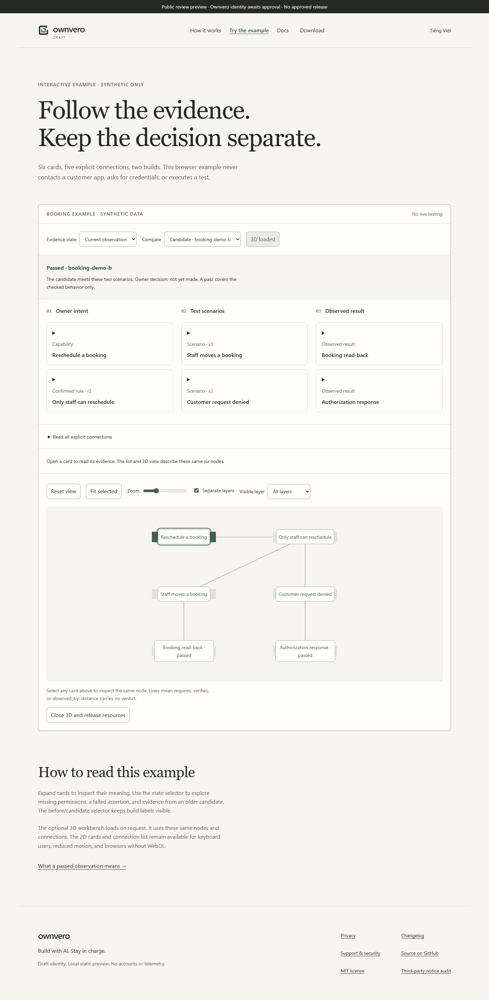

# GitHub Pages review preview — 2026-10-29

## Published preview

- URL: https://salyys1.github.io/what-changed/
- Source branch: `codex/ownvero-pages-preview`
- Source commit: `1599371c4fe90b13d43bc251a5724999bfc47d0d`
- Actions run: https://github.com/SalyyS1/what-changed/actions/runs/40912103756
- Deployment result: success

The deployment is a clearly labeled review preview. It contains static landing,
documentation, synthetic demo, optional 3D workbench, and the fail-closed
download page. It does not publish an installer, enable an `.exe` link, or
represent G2/G3 approval.

## Live checks

- Landing returned HTTP 200 and displayed the public review banner.
- `/demo/` returned the 3D load control and evidence canvas markup.
- Headless Edge loaded the live demo, clicked **Load 3D workbench**, rendered a
  WebGL canvas and six labels, and reported no page or console errors.
- `/download/` returned the unavailable state and contained no `.exe` link.
- Local build and site suite before push: 19 generated pages, `check-site` pass,
  wiki tests 10/10 pass.

## Review notes

The current presentation is intentionally calm and text-led. The evidence
cards explain the six nodes before 3D is loaded; controls expose reset, fit,
zoom, layer visibility, and separation. The list/cards remain the accessible
fallback. The top banner, download page, and docs repeatedly state that this
is synthetic development content and that no approved installer exists.
